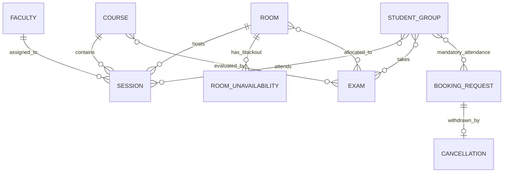

# Tech-Zephyr Data Architecture & Schema Specification

This document details the entity-relationship model, data schemas, identifiers, and relational integrity constraints of the official **Chilika Institute of Technology (CIT)** dataset (`cit_public.json`).

---

## 1. Entity-Relationship Overview

---

## 2. Core Entity Definitions

### 2.1 `rooms` (Campus Venues & Labs)
Total: **27 rooms**. Defines all physical spaces available for classes, labs, exams, and festival events.

| Field | Type | Description / Constraints |
| :--- | :--- | :--- |
| `id` | `string` (PK) | Unique venue code (e.g. `CR-101`, `LH-1`, `AUD`, `SH-1`, `CS-LAB1`, `OAT`) |
| `name` | `string` | Display name (e.g. "Lecture Hall 1", "Auditorium") |
| `building` | `string` | Campus facility (e.g. "Aryabhata Bhavan", "Main Building", "CS Block") |
| `type` | `string` (Enum) | `classroom`, `lecture_hall`, `auditorium`, `seminar_hall`, `outdoor`, `workshop`, `lab_cs`, `lab_elec`, `lab_phy`, `lab_civil` |
| `capacity` | `integer` | Physical seating capacity ($C$). Used directly for sessions, $\lfloor C/2 \rfloor$ for exams |
| `features` | `string[]` | Available equipment: `projector`, `audio_system`, `ac`, `computers`, `stage`, `pa_system`, `mic` |
| `accessible` | `boolean` | Wheelchair accessible ($H10$ constraint check) |
| `allowed_uses`| `string[]` | Allowed purposes: subset of `["lecture", "tutorial", "lab", "exam", "event"]` |

*Key Rules*: Seminar halls (`SH-1`, `SH-2`) and open-air theatre (`OAT`) have `allowed_uses: ["event"]` and cannot host regular classes.

---

### 2.2 `room_unavailability` (Maintenance Blackouts)
Total: **2 entries**. Hard periods where a room cannot be scheduled for any purpose ($H8$).

| Field | Type | Description |
| :--- | :--- | :--- |
| `room_id` | `string` (FK) | Reference to `rooms.id` |
| `day` | `string` (Enum) | Day of week (`MON`..`FRI`) |
| `periods` | `integer[]` | Periods during which the room is locked |
| `reason` | `string` | Explanation (e.g. "Scheduled AV system upgrade") |

---

### 2.3 `faculty` (Instructional Staff)
Total: **40 faculty members**.

| Field | Type | Description / Constraints |
| :--- | :--- | :--- |
| `id` | `string` (PK) | Faculty identifier (`F01` to `F40`) |
| `name` | `string` | Faculty full name |
| `department`| `string` | Academic department |
| `max_hours_per_day` | `integer` | **Hard constraint ($H12$)**: Maximum teaching hours in a single day (typically 4) |
| `needs_accessible` | `boolean` | Requires wheelchair-accessible classroom ($H10$) |
| `unavailable` | `object[]` | **Hard constraint ($H7$)**: Array of `{"day": str, "periods": int[], "reason": str}` |
| `preferences` | `object[]` | **Soft constraint ($S1$)**: Avoidance windows (`{"type": "avoid", "days": str[], "periods": int[], "note": str}`). Violation penalty: $+2$ pts/hr |

---

### 2.4 `student_groups` (Cohorts & Sections)
Total: **14 student groups**.

| Field | Type | Description |
| :--- | :--- | :--- |
| `id` | `string` (PK) | Cohort identifier (Year 1: `Y1-A`, `Y1-B`, `Y1-C`, `Y1-D`; Year 2: `CSE-2`, `ECE-2`, `ME-2`, `CE-2`, `EE-2`; Year 3: `CSE-3`, `ECE-3`, `ME-3`, `CE-3`, `EE-3`) |
| `name` | `string` | Cohort title |
| `year` | `integer` | Academic year (1, 2, or 3) |
| `department`| `string` | Academic discipline or General Engineering |
| `size` | `integer` | Student enrollment count (60 to 90 students) |
| `needs_accessible` | `boolean` | Student in group requires accessible venue ($H10$) |

---

### 2.5 `courses` (Academic Subjects)
Total: **62 courses**.

| Field | Type | Description |
| :--- | :--- | :--- |
| `id` | `string` (PK) | Course code (e.g. `CS101`, `MA101`, `OE301`) |
| `title` | `string` | Course title |
| `department` | `string` | Offering department |
| `year` | `integer` | Curricular year |
| `lecture_hours` | `integer` | Number of 1-hour lecture sessions per week |
| `tutorial_hours`| `integer` | Number of 1-hour tutorial sessions per week |
| `lab_blocks` | `integer` | Number of 3-hour practical lab sessions per week |

---

### 2.6 `sessions` (Schedulable Teaching Units)
Total: **189 sessions**, representing **243 total hours** weekly.

| Field | Type | Description / Constraints |
| :--- | :--- | :--- |
| `id` | `string` (PK) | Session ID (e.g. `MA101-AB-L1`, `CS191-A-P1`, `OE301-L1`, `ID101-ALL-L1`) |
| `course_id` | `string` (FK) | Reference to `courses.id` |
| `kind` | `string` (Enum) | `lecture` (1h), `tutorial` (1h), `lab` (3h) |
| `groups` | `string[]` (FK) | List of student group IDs attending this session |
| `faculty_id`| `string` (FK) | Assigned instructor ID (`faculty.id`) |
| `size` | `integer` | Combined headcount of all attending groups |
| `duration` | `integer` | Duration in periods (1 for lecture/tutorial, 3 for lab) |
| `room_types`| `string[]` | Compatible room types ($H6$) |
| `needs_accessible` | `boolean` | Requires accessible room ($H10$) |
| `basket_slot` | `string` or `null` | **Elective Basket Identifier ($H11$)**: Sessions with the same basket slot (e.g. `OEB-1`) must be scheduled simultaneously in different rooms |
| `fixed_slot` | `object` or `null` | **Hard constraint ($H14$)**: Inviolable predetermined slot (`{"day": str, "start_period": int}`) |

---

### 2.7 `booking_requests` (Spectra Week Events)
Total: **25 requests**.

| Field | Type | Description / Constraints |
| :--- | :--- | :--- |
| `id` | `string` (PK) | Request code (e.g. `BR-01` to `BR-20`, `BR-05a`..`BR-05e`, `BR-11a`/`BR-11b`) |
| `submitted_at` | `string` (ISO) | Timestamp used for priority tie-breaking |
| `requester` | `string` | Organization or faculty name |
| `role` | `string` (Enum) | `admin`, `faculty`, `department_coordinator`, `club` |
| `department` | `string` or `null` | Department if applicable |
| `requested_category` | `string` (Enum) | `institute_event`, `guest_lecture`, `department_event`, `club_event` |
| `title` | `string` | Event title |
| `attendance` | `integer` | Expected attendance (must fit in allocated room) |
| `duration_periods` | `integer` | Duration in periods |
| `windows` | `object[]` | Acceptable windows: `[{"day": str, "from_period": int, "to_period": int}]` |
| `room_types` | `string[]` | Compatible room types |
| `needs` | `string[]` | Equipment requirements: `stage`, `pa_system`, `projector`, `accessible` |
| `requested_room` | `string` or `null` | Preferred room wish (non-binding) |
| `mandatory_for_groups` | `string[]` | Groups that must be free of classes ($H13$) |
| `series_id` | `string` or `null` | Linked request series identifier |
| `raw_text` | `string` | Natural language text for AI parser |

---

### 2.8 `cancellations` (Withdrawn Requests)
Total: **1 cancellation** (`BR-04`).

| Field | Type | Description |
| :--- | :--- | :--- |
| `request_id` | `string` (FK) | Reference to `booking_requests.id` |
| `cancelled_at`| `string` (ISO) | Cancellation timestamp |
| `by` | `string` | Submitter of cancellation |
| `note` | `string` | Cancellation rationale |

*Key Rule ($B3$)*: Withdrawn requests must never be approved or offered alternatives.

---

### 2.9 `exams` (Midsem Examination Sessions)
Total: **41 exams**.

| Field | Type | Description / Constraints |
| :--- | :--- | :--- |
| `id` | `string` (PK) | Exam code (e.g. `EX-MA101`, `EX-CS201`) |
| `course_ids` | `string[]` (FK) | Courses being evaluated |
| `groups` | `string[]` (FK) | Cohorts sitting for this exam |
| `size` | `integer` | Total student count |
| `duration_hours` | `integer` | Exam length (2 hours) |

*Key Capacity Rule ($H5$)*: For exams, rooms seat half capacity ($\lfloor C/2 \rfloor$). An exam may span multiple rooms to meet required seating.

---

### 2.10 `calendar` (Temporal Model)

- **Teaching Days**: `["MON", "TUE", "WED", "THU", "FRI"]`.
- **Teaching Periods**: Periods 1 through 9:
  - P1: 08:00–09:00
  - P2: 09:00–10:00 (Allowed Lab Start)
  - P3: 10:00–11:00
  - P4: 11:00–12:00
  - P5: 12:00–13:00
  - *Lunch Break: 13:00–14:00 (No session may cross P5 into P6)*
  - P6: 14:00–15:00 (Allowed Lab Start)
  - P7: 15:00–16:00
  - P8: 16:00–17:00
  - P9: 17:00–18:00
- **Event-Only Periods**: Periods 10 through 13 (18:00–22:00).
- **Exam Week**: Monday through Saturday (`MON`–`SAT`), with slots `AM` (09:30–11:30) and `PM` (14:00–16:00).

